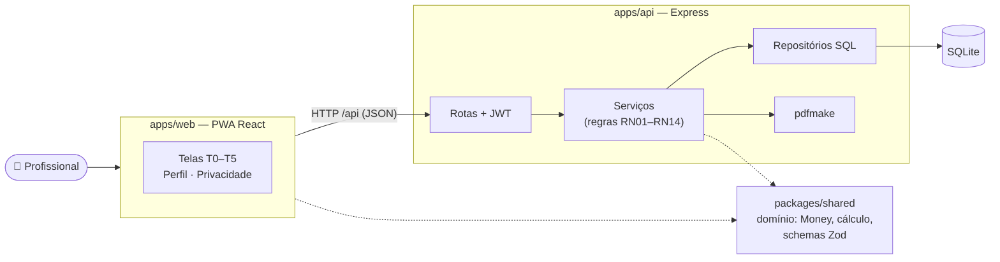
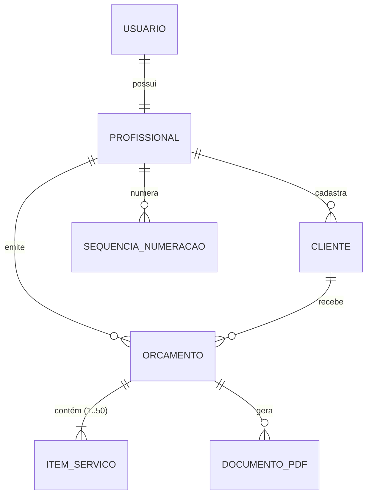

# OrçaFácil

> **Seu trabalho merece um orçamento profissional.**

O **OrçaFácil** é uma aplicação web *mobile-first* para prestadores de serviço autônomos (pintores, pedreiros, eletricistas…) montarem um orçamento, verem o total calculado automaticamente e gerarem um **PDF profissional** pronto para enviar pelo WhatsApp. Os dados ficam salvos na conta do usuário e podem ser acessados de qualquer navegador ou aparelho.

---

## Sumário

1. [Descrição do sistema](#1-descrição-do-sistema)
2. [Objetivo do MVP](#2-objetivo-do-mvp)
3. [Tecnologias](#3-tecnologias)
4. [Arquitetura](#4-arquitetura)
5. [Pré-requisitos](#5-pré-requisitos)
6. [Instalação](#6-instalação)
7. [Execução](#7-execução)
8. [Variáveis de ambiente](#8-variáveis-de-ambiente)
9. [Banco de dados](#9-banco-de-dados)
10. [API](#10-api)
11. [Testes](#11-testes)
12. [Protótipos](#12-protótipos)
13. [Documentação técnica](#13-documentação-técnica)

---

## 1. Descrição do sistema

| | |
|---|---|
| **Problema** | Orçamentos feitos em papel ou mensagens soltas no WhatsApp têm informações espalhadas e sem padrão, o que dificulta a compreensão do cliente e não transmite o cuidado do serviço. |
| **Público-alvo** | Profissionais que trabalham por conta própria e usam principalmente o celular. |
| **Solução** | Um fluxo guiado de 4 etapas que termina num PDF padronizado. |
| **Fluxo** | `01 Preencher` (cliente) → `02 Detalhar` (serviços e valores) → `03 Revisar` (prazo, pagamento, validade) → `04 PDF` (baixar e compartilhar) |

Funcionalidades implementadas:

| Funcionalidade | Requisitos | Histórias |
|---|---|---|
| Conta de usuário (cadastro/login) e dados disponíveis em qualquer aparelho | ADR-006 | — |
| Perfil do profissional reaproveitado em todos os orçamentos | RF01 | US01 |
| Dados do cliente e numeração automática `ORC-AAAA-NNNN` | RF02, RF03 | US02 |
| Itens com quantidade, unidade e valor; editar, remover e **desfazer** | RF04, RF05 | US03, US04 |
| Total calculado automaticamente (não editável) | RF06 | US03 |
| Prazo, condições de pagamento, validade e observações + revisão | RF07, RF08, RF09 | US05 |
| Geração do PDF no layout do protótipo | RF10 | US06 |
| Baixar e compartilhar (Web Share API) | RF11 | US07 |
| Histórico com busca, reabrir, baixar de novo, duplicar e excluir; salvamento automático do rascunho | RF12, RF13 | US08 |
| Privacidade (LGPD): apagar todos os dados | RNF21 | — |

## 2. Objetivo do MVP

Validar que um prestador de serviço consegue, **pelo celular e em poucos minutos**, sair do zero até um orçamento em PDF com aparência profissional — com cálculo sem erros, regras de negócio garantidas e os dados guardados com segurança para reenviar ou reaproveitar depois.

**Fora do escopo:** assinatura digital/aceite online, catálogo de preços, cobrança e nota fiscal, envio automático por e-mail/WhatsApp, relatórios financeiros.

## 3. Tecnologias

| Camada | Tecnologia |
|---|---|
| Interface | React 18, TypeScript, Vite 6, Tailwind CSS 4, React Router 7, TanStack Query 5, React Hook Form |
| PWA | vite-plugin-pwa (instalável, *app shell* em cache) |
| API | Node.js 22, Express 5, TypeScript (executado com `tsx`) |
| Banco de dados | SQLite (better-sqlite3) com migrações SQL |
| Autenticação | JWT (jsonwebtoken) + senhas com bcrypt |
| Validação | Zod — schemas compartilhados entre interface e API |
| PDF | pdfmake (gerado no servidor) |
| Documentação da API | OpenAPI 3 + Swagger UI |
| Testes | Vitest, Testing Library, supertest, Playwright |
| Organização | Monorepo com npm workspaces |

## 4. Arquitetura



- **`packages/shared`** — domínio puro (sem React/banco): cálculo em centavos, pendências para emissão, numeração, validações. É usado pela interface (validação imediata) e pela API (validação definitiva).
- **`apps/api`** — API REST em camadas: rotas → serviços (regras de negócio) → repositórios (SQL). Gera e guarda o PDF.
- **`apps/web`** — interface do protótipo; consome a API com TanStack Query e mostra estados de carregamento, sucesso e erro.

Detalhes: [docs/04-arquitetura.md](docs/04-arquitetura.md) · decisão: [ADR-006](docs/adr/ADR-006-api-rest-sqlite-contas.md).

```
.
├── apps/
│   ├── api/          # API REST (Express + SQLite) — openapi.yaml, src/, tests/
│   └── web/          # Interface (React + Vite) — src/, tests/
├── packages/
│   └── shared/       # Domínio compartilhado — src/, tests/
├── e2e/              # Testes ponta a ponta (Playwright)
├── docs/             # Documentação técnica, ADRs e protótipo
└── playwright.config.ts
```

## 5. Pré-requisitos

- **Node.js 20.19+** (recomendado 22 LTS) e **npm 10+**
- Git
- Nenhum banco para instalar: o SQLite é um arquivo criado automaticamente.
- (Opcional, para E2E) navegador do Playwright: `npx playwright install chromium`

## 6. Instalação

```bash
git clone https://github.com/Lucas-Bobato/OrcaFacil.git
cd OrcaFacil
npm install                 # instala api, web e shared (npm workspaces)

# variáveis de ambiente (opcional em desenvolvimento — há valores padrão)
cp apps/api/.env.example apps/api/.env
cp apps/web/.env.example apps/web/.env

npm run db:migrate          # cria o banco e as tabelas
npm run db:seed             # (opcional) dados de demonstração
```

## 7. Execução

**Desenvolvimento** (API + interface juntas, com recarga automática):

```bash
npm run dev
```

| Serviço | URL |
|---|---|
| Interface | http://localhost:5173 |
| API | http://localhost:3333/api |
| Documentação da API (Swagger) | http://localhost:3333/api/docs |

Com o seed, entre com **`demo@orcafacil.com.br` / `demo1234`** — ou crie uma conta na tela inicial. Para testar no celular na mesma rede, rode `npm run dev -w @orcafacil/web -- --host` e acesse pelo IP do computador.

**Produção** (build da interface + API):

```bash
npm run build               # gera apps/web/dist
NODE_ENV=production JWT_SECRET=<segredo-longo> npm start   # sobe a API
```

A pasta `apps/web/dist` é estática (pode ir para a Vercel/qualquer CDN); defina `VITE_API_URL` com a URL pública da API antes do build e `CORS_ORIGIN` na API com o domínio da interface.

## 8. Variáveis de ambiente

**API** — `apps/api/.env` (modelo em [`apps/api/.env.example`](apps/api/.env.example)):

| Variável | Padrão | Descrição |
|---|---|---|
| `PORT` | `3333` | Porta HTTP da API |
| `DATABASE_PATH` | `./data/orcafacil.db` | Caminho do arquivo SQLite (relativo a `apps/api`) |
| `JWT_SECRET` | valor de desenvolvimento | Segredo dos tokens. **Obrigatório** com `NODE_ENV=production` |
| `JWT_EXPIRES_IN` | `7d` | Validade do token (`12h`, `7d`…) |
| `CORS_ORIGIN` | `http://localhost:5173` | Origens permitidas, separadas por vírgula |
| `NODE_ENV` | — | `production` exige `JWT_SECRET` |

**Interface** — `apps/web/.env` (modelo em [`apps/web/.env.example`](apps/web/.env.example)):

| Variável | Padrão | Descrição |
|---|---|---|
| `VITE_API_URL` | `/api` | URL base da API. Em desenvolvimento deixe vazio (o Vite encaminha `/api`) |
| `API_PROXY_TARGET` | `http://localhost:3333` | (dev) destino do proxy `/api` do Vite |
| `WEB_PORT` | `5173` | (dev) porta do servidor da interface |

## 9. Banco de dados

- **SGBD:** SQLite 3, arquivo em `apps/api/data/orcafacil.db` (ignorado pelo Git).
- **Esquema:** migração [`apps/api/src/db/migrations/001_inicial.sql`](apps/api/src/db/migrations/001_inicial.sql), coerente com o DER de [docs/05-modelagem-dados.md](docs/05-modelagem-dados.md).
- **Tabelas:** `usuario`, `profissional`, `cliente`, `orcamento`, `item_servico`, `documento_pdf`, `sequencia_numeracao` (+ `schema_migrations` para controle).
- **Integridade:** chaves primárias (UUID), chaves estrangeiras com cascata/restrição, `UNIQUE`, `CHECK` com as regras RN01/RN04/RN05/RN06/RN09, *trigger* que impede reutilizar números (RN07) e índices para busca e listagem.
- **Migrações:** `npm run db:migrate` aplica as pendentes (a API também aplica ao iniciar).
- **Dados de teste:** `npm run db:seed` recria o usuário demo com perfil, 3 clientes e 3 orçamentos (2 emitidos com PDF e 1 rascunho).
- **Recomeçar do zero:** apague a pasta `apps/api/data/` e rode `npm run db:migrate`.



## 10. API

Endpoints documentados em **OpenAPI** ([`apps/api/openapi.yaml`](apps/api/openapi.yaml)), navegáveis no **Swagger UI** em `http://localhost:3333/api/docs`, e resumidos com exemplos em [docs/06-api.md](docs/06-api.md).

| Recurso | Endpoints |
|---|---|
| Conta | `POST /auth/cadastro` · `POST /auth/login` · `GET /auth/me` · `DELETE /conta` |
| Perfil | `GET /perfil` · `PUT /perfil` |
| Clientes | `GET/POST /clientes` · `GET/PUT/DELETE /clientes/:id` |
| Orçamentos | `GET/POST /orcamentos` · `GET/PUT/DELETE /orcamentos/:id` · `PUT /orcamentos/:id/cliente` · `POST /orcamentos/:id/duplicar` |
| Itens | `POST /orcamentos/:id/itens` · `PUT/DELETE /orcamentos/:id/itens/:itemId` |
| PDF | `POST /orcamentos/:id/emitir` · `GET /orcamentos/:id/pdf` |

Erros seguem sempre o formato `{ "erro": { "codigo", "mensagem", "campos"?, "pendencias"? } }`.

## 11. Testes

```bash
npm test                          # domínio + API + interface (Vitest)
npm run test:coverage             # com cobertura
npx playwright install chromium   # uma vez
npm run test:e2e                  # ponta a ponta (sobe API + interface com banco descartável)
npm run typecheck                 # TypeScript em modo strict em todos os pacotes
```

| Suíte | Testes | Cobre |
|---|---|---|
| Domínio (`packages/shared`) | 69 | Cálculos, arredondamento, BRL, regras RN01–RN13, validações |
| API (`apps/api`) | 54 | Endpoints, regras de negócio, erros, autenticação, isolamento, restrições do banco |
| Interface (`apps/web`) | 22 | Formulários, máscaras, estados de carregamento/erro, botões condicionais |
| E2E (`e2e/`) | 5 | Fluxo completo no navegador, mesmos dados em outro navegador, 360 px, apagar dados |

Rastreabilidade de cada critério de aceite para os testes: [docs/07-testes.md](docs/07-testes.md).

## 12. Protótipos

- **Figma (fonte de verdade da interface):** [OrçaFácil — Protótipo MVP](https://www.figma.com/design/49nWhL3pQQirvTCHLlyNTN/OrcaFacil-Prototipo-MVP)
- Telas exportadas e mapa de navegação: [docs/03-prototipacao.md](docs/03-prototipacao.md)

| Tela do protótipo | Rota na aplicação |
|---|---|
| T0 · Meus orçamentos | `/` |
| T1 · Meu perfil | `/perfil` |
| T2 · 01 Preencher | `/orcamentos/:id/preencher` |
| T3 · 02 Detalhar | `/orcamentos/:id/detalhar` |
| T4 · 03 Revisar | `/orcamentos/:id/revisar` |
| T5 · 04 PDF pronto | `/orcamentos/:id/pdf` |
| Privacidade | `/privacidade` |
| *(novas)* Entrar / Criar conta | `/entrar`, `/cadastrar` |

## 13. Documentação técnica

| # | Documento | Conteúdo |
|---|---|---|
| 1 | [Requisitos Funcionais, Histórias e Regras](docs/01-requisitos-funcionais.md) | RF, US com critérios de aceite (BDD) e RN |
| 2 | [Requisitos Não Funcionais](docs/02-requisitos-nao-funcionais.md) | RNF mensuráveis |
| 3 | [Prototipação](docs/03-prototipacao.md) | Mapa de navegação, componentes, telas e PDF |
| 4 | [Arquitetura](docs/04-arquitetura.md) + [ADRs](docs/adr/README.md) | Componentes, fluxo de emissão, decisões |
| 5 | [Modelagem de Dados (DER)](docs/05-modelagem-dados.md) | DER, dicionário de dados, implementação SQLite |
| 6 | [API](docs/06-api.md) | Endpoints, regras, erros e exemplos |
| 7 | [Testes](docs/07-testes.md) | Suítes, como executar e rastreabilidade |

### Rastreabilidade (visão rápida)

| Etapa do fluxo | Requisitos | Histórias | Regras |
|---|---|---|---|
| Configurar perfil | RF01 | US01 | RN11 |
| 01 Preencher | RF02, RF03 | US02 | RN01, RN07 |
| 02 Detalhar | RF04, RF05, RF06 | US03, US04 | RN02, RN03, RN04, RN08, RN09, RN14 |
| 03 Revisar | RF07, RF08, RF09 | US05 | RN05, RN06 |
| 04 Gerar PDF | RF10, RF11 | US06, US07 | RN01, RN10, RN12, RN13 |
| Histórico | RF12, RF13 | US08 | RN10, RN14 |

Material original (pitch e levantamento inicial): [docs/material-original](docs/material-original/).
