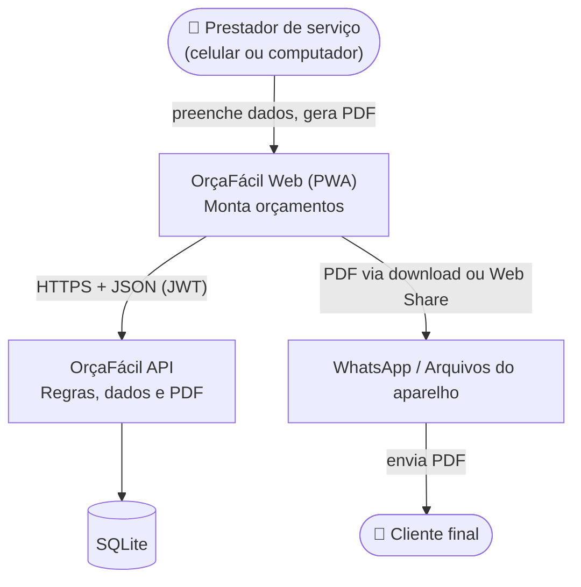
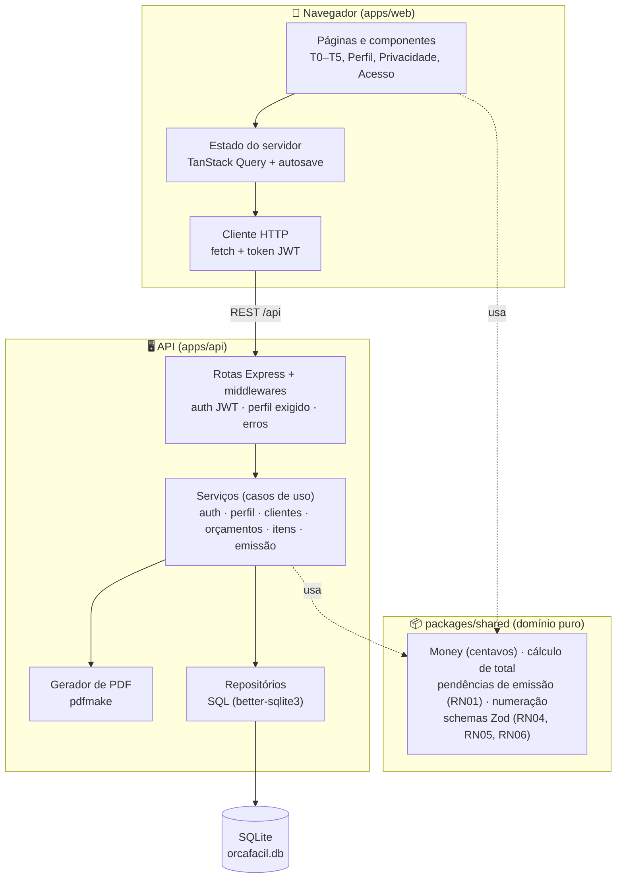
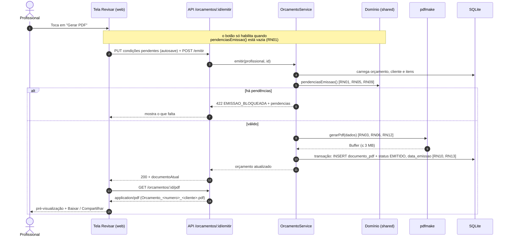

# 4. Arquitetura de Software

[← Voltar ao README](../README.md) · [ADRs](adr/README.md)

## 4.1 Visão geral

O OrçaFácil é composto por uma **interface web (PWA React)** e uma **API REST (Node.js + Express)** que guarda os dados em **SQLite**. O usuário cria uma conta e acessa os mesmos orçamentos em qualquer navegador ou aparelho. As regras de negócio ficam num pacote de **domínio compartilhado** (`packages/shared`), usado pela interface (validação imediata e cálculo na tela) e pela API (validação definitiva e persistência).

Decisão que fundamenta a arquitetura atual: [ADR-006 — API REST com SQLite e contas](adr/ADR-006-api-rest-sqlite-contas.md), que substitui a abordagem local-first do [ADR-001](adr/ADR-001-arquitetura-local-first-pwa.md). Continuam válidos o [ADR-002](adr/ADR-002-frontend-react-typescript-vite.md) (frontend) e o [ADR-004](adr/ADR-004-geracao-pdf-pdfmake.md) (pdfmake, agora no servidor).

## 4.2 Diagrama de contexto (C4 — nível 1)



## 4.3 Contêineres e componentes (C4 — níveis 2/3)



### Responsabilidades por camada

| Camada | Pasta | Responsabilidade | Regra de dependência |
|---|---|---|---|
| **Domínio** | `packages/shared/src` | `Money` em centavos, subtotal/total, pendências para emissão, numeração, nome do arquivo, schemas Zod e DTOs. **Código puro**, sem React nem banco. | Não depende de nenhuma outra camada. |
| **Apresentação** | `apps/web/src/pages`, `components` | Telas do protótipo, máscaras, estados de carregamento/erro/sucesso. | Usa Domínio e o cliente HTTP. |
| **Estado/Integração** | `apps/web/src/api`, `lib` | Hooks de consulta e mutação (TanStack Query), autosave com *debounce*, download/compartilhamento. | Fala com a API apenas por HTTP. |
| **Rotas** | `apps/api/src/routes.ts`, `middleware/` | Endpoints REST, autenticação, conversão de erros para o formato padrão. | Chama Serviços. |
| **Serviços** | `apps/api/src/services` | Casos de uso e regras RN01–RN14 (numeração, total, ciclo de vida, limite de itens, emissão). | Usa Domínio, Repositórios e PDF. |
| **Infraestrutura** | `apps/api/src/repositories`, `db/`, `pdf/` | SQL, migrações, conexão SQLite, geração do PDF. | Implementa o que os Serviços precisam. |

## 4.4 Fluxo principal — Gerar PDF (sequência)



## 4.5 Estrutura de pastas

```
.
├── packages/shared/          # Domínio compartilhado (TypeScript puro)
│   ├── src/money.ts          # centavos ↔ BRL, máscara
│   ├── src/orcamento.ts      # subtotal, total, pendências, validade
│   ├── src/numeracao.ts      # ORC-AAAA-NNNN, nome do arquivo
│   ├── src/documento.ts      # CPF/CNPJ, telefone
│   ├── src/schemas.ts        # validações Zod (mensagens dos CAs)
│   └── tests/
├── apps/api/                 # API REST
│   ├── openapi.yaml          # documentação dos endpoints (Swagger em /api/docs)
│   ├── src/db/               # conexão, migrações SQL, seed
│   ├── src/repositories/     # acesso a dados
│   ├── src/services/         # regras de negócio
│   ├── src/pdf/              # layout do PDF
│   ├── src/middleware/       # auth e tratamento de erros
│   └── tests/                # Vitest + supertest
├── apps/web/                 # Interface (React + Vite + Tailwind)
│   ├── src/pages/            # T0..T5, Perfil, Privacidade, Acesso
│   ├── src/components/       # biblioteca do protótipo
│   ├── src/api/              # cliente HTTP e hooks
│   └── tests/                # Testing Library
└── e2e/                      # Playwright (fluxo completo)
```

## 4.6 Estratégia de qualidade

| Nível | Ferramenta | Foco |
|---|---|---|
| Unitário | Vitest | Domínio: `Money`, arredondamento, validações, numeração, CPF/CNPJ |
| Integração da API | Vitest + supertest + SQLite em memória | Endpoints, regras de negócio, erros, isolamento entre usuários, restrições do banco |
| Componente | Vitest + Testing Library | Formulários, máscaras, habilitação do "Gerar PDF", Desfazer, estados de carregamento/erro |
| E2E | Playwright (Chromium, viewport Pixel 7) | Fluxo completo web → API → SQLite, mesmo dado em outro navegador, 360 px, apagar dados |

Detalhes e rastreabilidade dos testes: [07-testes.md](07-testes.md).
