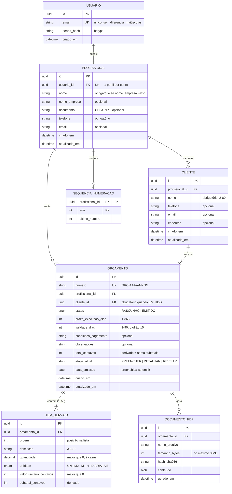

# 5. Modelagem de Dados (DER)

[← Voltar ao README](../README.md) · Decisão relacionada: [ADR-006 — API REST com SQLite e contas](adr/ADR-006-api-rest-sqlite-contas.md)

O modelo abaixo é implementado em **SQLite** pela migração [`apps/api/src/db/migrations/001_inicial.sql`](../apps/api/src/db/migrations/001_inicial.sql), com chaves primárias, chaves estrangeiras (`PRAGMA foreign_keys = ON`), restrições `CHECK`/`UNIQUE`, índices e um *trigger*. Uma versão equivalente para PostgreSQL está na seção 5.5 como referência para uma futura migração.

> **Mudanças em relação à versão local-first** (ADR-006): entrou a entidade **USUARIO** (conta de acesso, 1:1 com PROFISSIONAL); a numeração passou a ser **por profissional e ano**; `ORCAMENTO.cliente_id` pode ficar vazio **apenas enquanto RASCUNHO** (orçamento recém-criado ou duplicado — CA08.4).

## 5.1 Diagrama Entidade-Relacionamento



> `SEQUENCIA_NUMERACAO` é uma tabela de controle que garante a numeração única e não reutilizável dos orçamentos de cada profissional (RN07). Um *trigger* impede que o número seja decrementado.

## 5.2 Relacionamentos e cardinalidades

| Relacionamento | Cardinalidade | Descrição | Regra na exclusão |
|---|---|---|---|
| USUARIO → PROFISSIONAL | 1 : 0..1 | Cada conta tem um perfil (criado no 1º acesso — CA01.1). | **Cascata**: apagar a conta (RNF21) remove tudo. |
| PROFISSIONAL → CLIENTE | 1 : 0..N | Um profissional cadastra vários clientes. | **Cascata**. |
| PROFISSIONAL → ORCAMENTO | 1 : 0..N | Um profissional emite vários orçamentos. | Idem. |
| CLIENTE → ORCAMENTO | 1 : 0..N | Um cliente pode receber vários orçamentos; cada orçamento emitido pertence a exatamente 1 cliente. | **Restrita** (`NO ACTION`): cliente com orçamentos não pode ser excluído (API responde 409). |
| ORCAMENTO → ITEM_SERVICO | 1 : 1..50 | Composição: itens não existem fora do orçamento (RN09). Um rascunho pode ter 0 itens temporariamente; para emitir, ≥ 1. | **Cascata**. |
| ORCAMENTO → DOCUMENTO_PDF | 1 : 0..1 | Cada emissão gera um PDF, que substitui o anterior (RN10). A tabela não impõe a unicidade; o serviço de emissão apaga o anterior na mesma transação. | **Cascata**. |

> Todas as consultas da API filtram pelo `profissional_id` da sessão: um usuário nunca enxerga dados de outro (a API responde 404).

## 5.3 Dicionário de dados

### USUARIO — conta de acesso (ADR-006)

| Atributo | Tipo | Nulo | Restrições / Observações |
|---|---|---|---|
| id | UUID v4 | Não | PK |
| email | texto (120) | Não | **Único** (`COLLATE NOCASE`); normalizado para minúsculas |
| senha_hash | texto | Não | Hash bcrypt (custo 10); a senha nunca é armazenada nem devolvida |
| token_versao | inteiro | Não | Versão dos tokens da conta; aumentar invalida os já emitidos (logout, troca de senha). Migração `002_seguranca.sql` |
| criado_em | data-hora | Não | |

### PROFISSIONAL — perfil de quem emite o orçamento (RF01)

| Atributo | Tipo | Nulo | Restrições / Observações |
|---|---|---|---|
| id | UUID v4 | Não | PK |
| usuario_id | UUID | Não | FK → USUARIO.id (cascata); **único** (1 perfil por conta) |
| nome | texto (80) | Sim* | *Obrigatório se `nome_empresa` for nulo (RN01) |
| nome_empresa | texto (80) | Sim | Exibido em destaque no cabeçalho do PDF quando informado |
| documento | texto (18) | Sim | CPF (11 dígitos) ou CNPJ (14 dígitos), validado por dígito verificador; armazenado só com números |
| telefone | texto (11) | Não | 10–11 dígitos (DDD + número), armazenado só com números |
| email | texto (120) | Sim | Formato de e-mail válido |
| criado_em / atualizado_em | data-hora ISO 8601 | Não | Preenchidos automaticamente |

### CLIENTE — destinatário do orçamento (RF02)

| Atributo | Tipo | Nulo | Restrições / Observações |
|---|---|---|---|
| id | UUID v4 | Não | PK |
| profissional_id | UUID | Não | FK → PROFISSIONAL.id |
| nome | texto (80) | Não | 2–80 caracteres; indexado para busca (CA08.2) |
| telefone | texto (11) | Sim | 10–11 dígitos |
| email | texto (120) | Sim | |
| endereco | texto (200) | Sim | Endereço onde o serviço será realizado |
| criado_em / atualizado_em | data-hora | Não | |

### ORCAMENTO — proposta comercial (RF03, RF06–RF09)

| Atributo | Tipo | Nulo | Restrições / Observações |
|---|---|---|---|
| id | UUID v4 | Não | PK |
| numero | texto (13) | Não | **Único por profissional**; formato `ORC-AAAA-NNNN` (RN07, CHECK com `GLOB`) |
| profissional_id | UUID | Não | FK → PROFISSIONAL.id |
| cliente_id | UUID | Sim* | FK → CLIENTE.id; *obrigatório quando `EMITIDO` (CHECK) |
| status | enum | Não | `RASCUNHO` (padrão) ou `EMITIDO` (RN10) |
| prazo_execucao_dias | inteiro | Sim* | 1–365; *obrigatório para emitir (RN05) |
| validade_dias | inteiro | Não | 1–90; padrão 15 (RN06) |
| condicoes_pagamento | texto (500) | Sim | Ex.: "50% no início e 50% na conclusão" |
| observacoes | texto (1000) | Sim | Ex.: "Materiais por conta do cliente" |
| total_centavos | inteiro | Não | **Derivado** = Σ `ITEM_SERVICO.subtotal_centavos`; nunca editado pelo usuário (RN02). Persistido para listagem rápida. |
| etapa_atual | enum | Não | Etapa onde o usuário parou (CA08.3) |
| data_emissao | data | Sim | Preenchida automaticamente ao emitir (RN13) |
| criado_em / atualizado_em | data-hora | Não | `atualizado_em` indexado (ordenação da lista) |

### ITEM_SERVICO — linha do orçamento (RF04, RF05)

| Atributo | Tipo | Nulo | Restrições / Observações |
|---|---|---|---|
| id | UUID v4 | Não | PK |
| orcamento_id | UUID | Não | FK → ORCAMENTO.id (cascata) |
| ordem | inteiro | Não | 1..50, define a ordem na lista e no PDF |
| descricao | texto (120) | Não | 3–120 caracteres (RN04) |
| quantidade | decimal(7,2) | Não | > 0 e ≤ 99.999,99 (RN04) |
| unidade | enum | Não | `UN`, `M2`, `M`, `H`, `DIARIA`, `VB` (verba) |
| valor_unitario_centavos | inteiro | Não | > 0 e ≤ 999.999.999 (RN04, RN08) |
| subtotal_centavos | inteiro | Não | **Derivado** = arredondar(quantidade × valor_unitario_centavos) (RN08) |

### DOCUMENTO_PDF — arquivo gerado (RF10, RF11)

| Atributo | Tipo | Nulo | Restrições / Observações |
|---|---|---|---|
| id | UUID v4 | Não | PK |
| orcamento_id | UUID | Não | FK → ORCAMENTO.id (cascata); indexado |
| nome_arquivo | texto (80) | Não | `Orcamento_<numero>_<cliente>.pdf` (RN12) |
| tamanho_bytes | inteiro | Não | ≤ 3.145.728 (3 MB — RNF06) |
| hash_sha256 | texto (64) | Não | Integridade do arquivo |
| conteudo | Blob | Não | `application/pdf` — é o *snapshot* imutável do orçamento na emissão (RN11) |
| gerado_em | data-hora | Não | Indexado; o mais recente é o PDF vigente |

### SEQUENCIA_NUMERACAO — controle de numeração (RN07)

| Atributo | Tipo | Nulo | Restrições / Observações |
|---|---|---|---|
| profissional_id | UUID | Não | PK composta; FK → PROFISSIONAL.id (cascata) |
| ano | inteiro | Não | PK composta (ex.: 2026) |
| ultimo_numero | inteiro | Não | Incrementado em transação ao criar orçamento (`INSERT … ON CONFLICT DO UPDATE … RETURNING`); *trigger* impede decrementar |

## 5.4 Implementação física — SQLite

| Item | Onde |
|---|---|
| Migração (DDL completa) | [`apps/api/src/db/migrations/001_inicial.sql`](../apps/api/src/db/migrations/001_inicial.sql) |
| Conexão e executor de migrações | [`apps/api/src/db/connection.ts`](../apps/api/src/db/connection.ts) — liga `foreign_keys`, WAL e registra a função `normalizar()` (busca sem acentos) |
| Dados iniciais (seed) | [`apps/api/src/db/seed.ts`](../apps/api/src/db/seed.ts) — usuário demo, perfil, 3 clientes e 3 orçamentos (2 emitidos com PDF, 1 rascunho) |
| Testes das restrições | [`apps/api/tests/clientes-banco.test.ts`](../apps/api/tests/clientes-banco.test.ts) |

Restrições de integridade implementadas:

| Tipo | Restrições |
|---|---|
| **Chaves primárias** | UUID (`TEXT`) em todas as entidades; PK composta `(profissional_id, ano)` em `sequencia_numeracao` |
| **Chaves estrangeiras** | `profissional.usuario_id`, `cliente.profissional_id`, `orcamento.profissional_id`, `orcamento.cliente_id`, `item_servico.orcamento_id`, `documento_pdf.orcamento_id`, `sequencia_numeracao.profissional_id` |
| **Únicas** | `usuario.email`, `profissional.usuario_id`, `(orcamento.profissional_id, numero)`, `(item_servico.orcamento_id, ordem)` |
| **CHECK** | nome **ou** empresa (RN01a); tamanhos de texto; telefone 10–11 dígitos; CPF/CNPJ 11/14 dígitos; status e etapa válidos; prazo 1–365 (RN05); validade 1–90 (RN06); quantidade > 0 e ≤ 99.999,99, valor > 0 e ≤ 9.999.999,99 (RN04); ordem 1–50 (RN09); PDF ≤ 3 MB (RNF06); emitido exige cliente, prazo e data de emissão |
| **Trigger** | `trg_sequencia_nao_decrementa` — números nunca são reutilizados (RN07) |
| **Índices** | `idx_cliente_profissional_nome`, `idx_orcamento_profissional_atualizado` (lista ordenada — CA08.1), `idx_orcamento_cliente`, `idx_documento_orcamento` (PDF vigente) |

Exemplo de operação atômica — **emitir orçamento** (RN10, RN13), em [`orcamentoService.ts`](../apps/api/src/services/orcamentoService.ts):

```ts
db.transaction(() => {
  documentosRepo.inserir(db, { id, orcamentoId, nomeArquivo, tamanhoBytes, hashSha256, conteudo: pdf, geradoEm: agora });
  orcamentosRepo.atualizar(db, orcamentoId, { status: 'EMITIDO', dataEmissao, totalCentavos, etapaAtual: 'REVISAR' }, agora);
})();
```

## 5.5 Equivalente relacional (DDL PostgreSQL — referência)

```sql
CREATE TABLE usuario (
  id          UUID PRIMARY KEY,
  email       VARCHAR(120) NOT NULL UNIQUE,
  senha_hash  TEXT         NOT NULL,
  criado_em   TIMESTAMP    NOT NULL
);

CREATE TABLE profissional (
  id             UUID PRIMARY KEY,
  usuario_id     UUID         NOT NULL UNIQUE REFERENCES usuario(id) ON DELETE CASCADE,
  nome           VARCHAR(80),
  nome_empresa   VARCHAR(80),
  documento      VARCHAR(14),
  telefone       VARCHAR(11)  NOT NULL,
  email          VARCHAR(120),
  criado_em      TIMESTAMP    NOT NULL,
  atualizado_em  TIMESTAMP    NOT NULL,
  CHECK (nome IS NOT NULL OR nome_empresa IS NOT NULL)
);

CREATE TABLE cliente (
  id               UUID PRIMARY KEY,
  profissional_id  UUID         NOT NULL REFERENCES profissional(id) ON DELETE CASCADE,
  nome             VARCHAR(80)  NOT NULL CHECK (char_length(nome) >= 2),
  telefone         VARCHAR(11),
  email            VARCHAR(120),
  endereco         VARCHAR(200),
  criado_em        TIMESTAMP    NOT NULL,
  atualizado_em    TIMESTAMP    NOT NULL
);
CREATE INDEX idx_cliente_nome ON cliente(nome);

CREATE TABLE orcamento (
  id                   UUID PRIMARY KEY,
  numero               VARCHAR(13)  NOT NULL,
  profissional_id      UUID         NOT NULL REFERENCES profissional(id) ON DELETE CASCADE,
  cliente_id           UUID         REFERENCES cliente(id) ON DELETE RESTRICT,
  status               VARCHAR(10)  NOT NULL DEFAULT 'RASCUNHO'
                                    CHECK (status IN ('RASCUNHO','EMITIDO')),
  prazo_execucao_dias  INTEGER      CHECK (prazo_execucao_dias BETWEEN 1 AND 365),
  validade_dias        INTEGER      NOT NULL DEFAULT 15 CHECK (validade_dias BETWEEN 1 AND 90),
  condicoes_pagamento  VARCHAR(500),
  observacoes          VARCHAR(1000),
  total_centavos       BIGINT       NOT NULL DEFAULT 0 CHECK (total_centavos >= 0),
  etapa_atual          VARCHAR(10)  NOT NULL DEFAULT 'PREENCHER',
  data_emissao         DATE,
  criado_em            TIMESTAMP    NOT NULL,
  atualizado_em        TIMESTAMP    NOT NULL,
  UNIQUE (profissional_id, numero),
  CHECK (status = 'RASCUNHO' OR (data_emissao IS NOT NULL AND prazo_execucao_dias IS NOT NULL AND cliente_id IS NOT NULL))
);
CREATE INDEX idx_orcamento_atualizado ON orcamento(atualizado_em DESC);

CREATE TABLE item_servico (
  id                       UUID PRIMARY KEY,
  orcamento_id             UUID          NOT NULL REFERENCES orcamento(id) ON DELETE CASCADE,
  ordem                    SMALLINT      NOT NULL CHECK (ordem BETWEEN 1 AND 50),
  descricao                VARCHAR(120)  NOT NULL CHECK (char_length(descricao) >= 3),
  quantidade               NUMERIC(7,2)  NOT NULL CHECK (quantidade > 0),
  unidade                  VARCHAR(6)    NOT NULL
                                         CHECK (unidade IN ('UN','M2','M','H','DIARIA','VB')),
  valor_unitario_centavos  BIGINT        NOT NULL CHECK (valor_unitario_centavos > 0),
  subtotal_centavos        BIGINT        NOT NULL CHECK (subtotal_centavos > 0),
  UNIQUE (orcamento_id, ordem)
);

CREATE TABLE documento_pdf (
  id             UUID PRIMARY KEY,
  orcamento_id   UUID         NOT NULL REFERENCES orcamento(id) ON DELETE CASCADE,
  nome_arquivo   VARCHAR(80)  NOT NULL,
  tamanho_bytes  INTEGER      NOT NULL CHECK (tamanho_bytes <= 3145728),
  hash_sha256    CHAR(64)     NOT NULL,
  conteudo       BYTEA        NOT NULL,
  gerado_em      TIMESTAMP    NOT NULL
);
CREATE INDEX idx_documento_orcamento ON documento_pdf(orcamento_id, gerado_em DESC);

CREATE TABLE sequencia_numeracao (
  profissional_id  UUID     NOT NULL REFERENCES profissional(id) ON DELETE CASCADE,
  ano              SMALLINT NOT NULL,
  ultimo_numero    INTEGER  NOT NULL DEFAULT 0 CHECK (ultimo_numero >= 0),
  PRIMARY KEY (profissional_id, ano)
);
```

## 5.6 Decisões de modelagem

| Decisão | Justificativa |
|---|---|
| Valores monetários em **centavos inteiros** | Evita erros de ponto flutuante (ex.: `0.1 + 0.2 ≠ 0.3`) — RN08, RNF11. |
| `total_centavos` e `subtotal_centavos` **persistidos** apesar de derivados | Permite listar orçamentos sem carregar itens; recalculados pelo Domínio a cada alteração, nunca editados manualmente (RN02). |
| **UUID** como chave primária | Não expõe a quantidade de registros nas URLs e evita colisões numa futura sincronização offline. |
| PDF armazenado como **snapshot** (`DOCUMENTO_PDF.conteudo`) | Garante que o documento enviado ao cliente não muda se o perfil ou o cliente forem editados depois (RN11). |
| Tabela `SEQUENCIA_NUMERACAO` separada | Garante números não reutilizados mesmo após exclusões (RN07). |
| `CLIENTE` como entidade própria (e não texto dentro do orçamento) | Permite reaproveitar o cliente em novos orçamentos e buscar por cliente (RF12). |
